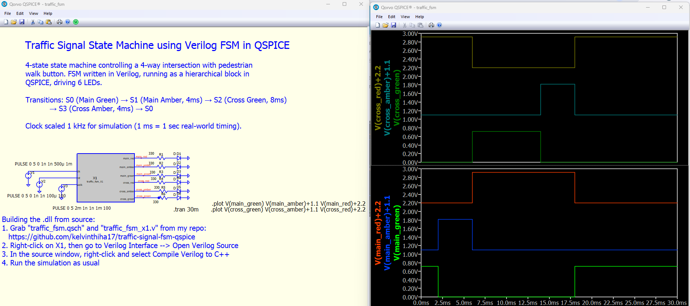

# Traffic Signal FSM: QSPICE Simulation to FPGA Hardware

A 4-state finite state machine controlling an intersection between a Main Road and a Cross Road, with a pedestrian walk button. The design was first simulated in **QSPICE**, then rewritten in **SystemVerilog** and run on real hardware on an **AMD Spartan-7 FPGA** (RealDigital Boolean board).

<!-- Demo video: drag your MP4 into this README on github.com, right here -->

## Project history

1. **Breadboard (Fall 2024):** originally built as a discrete TTL circuit on a breadboard for the Rutgers Digital Logic Lab.
2. **QSPICE simulation (Jul 2026):** rebuilt from scratch as a Verilog module in QSPICE to clean up the design and verify the state transitions in simulation. See [`qspice/`](qspice/).
3. **FPGA hardware (Nov 2026):** ported to an FPGA in Vivado and rewritten in SystemVerilog for a real 100 MHz clock, real buttons, and real LEDs. See [`fpga/`](fpga/).

## States

| State | Main Road | Cross Road | Duration                       |
| ----- | --------- | ---------- | ------------------------------ |
| S0    | Green     | Red        | Default, waits for walk button |
| S1    | Amber     | Red        | 4 ticks                        |
| S2    | Red       | Green      | 8 ticks                        |
| S3    | Red       | Amber      | 4 ticks                        |

Cycle triggered by a walk button press: S0 → S1 → S2 → S3 → S0. On the FPGA, one tick is one second.

---

## FPGA version

**Board:** RealDigital Boolean board, AMD Spartan-7 `xc7s50csga324-1`, 100 MHz oscillator
**Tools:** AMD Vivado 2026.1 (synthesis, implementation, XSim simulation)
**Language:** SystemVerilog

### Block diagram

```
            ┌──────────────┐  rst, walk   ┌───────────────┐   6 light   ┌──────────────┐
 btn[1:0] ─►│ 2-FF button  ├─────────────►│               │   signals   │ RGB0 (main)  │
            │ synchronizers│              │  traffic_fsm  ├────────────►│ RGB1 (cross) │
            └──────────────┘              │  (Moore FSM)  │             │ LD0–LD5      │
            ┌──────────────┐    tick      │               │             └──────────────┘
 clk ──────►│   tick_gen   ├─────────────►│               │
 (100 MHz)  │  (N = 10^8)  │  1 Hz enable └───────────────┘
            └──────────────┘
                  all blocks clocked by the same 100 MHz clk
```

### Files

| File | Description |
| ---- | ----------- |
| [`fpga/rtl/tick_gen.sv`](fpga/rtl/tick_gen.sv) | Parameterized counter that outputs a 1-cycle `tick` every N clocks (1 Hz at N = 100,000,000) |
| [`fpga/rtl/traffic_fsm.sv`](fpga/rtl/traffic_fsm.sv) | Moore FSM with enum states, per-state timing counter, and latched walk request |
| [`fpga/rtl/top.sv`](fpga/rtl/top.sv) | Board wrapper: button synchronizers, module instances, LED mapping |
| [`fpga/tb/tick_gen_tb.sv`](fpga/tb/tick_gen_tb.sv) | Self-checking testbench for `tick_gen` |
| [`fpga/constraints/traffic_fsm.xdc`](fpga/constraints/traffic_fsm.xdc) | Pin assignments and 100 MHz clock constraint |

### Design decisions (what changed from the QSPICE version)

- **Clock enable instead of a divided clock.** Everything runs on the single 100 MHz clock. `tick_gen` produces a one-cycle pulse once per second, and the FSM only updates on cycles where `tick` is high. Making a slow clock from logic would bypass the FPGA's dedicated clock routing and cause timing problems; an enable keeps the design fully synchronous.
- **Latched walk request.** The FSM only looks at its inputs once per second, so a quick button tap between ticks would be missed. A `walk_req` register sets on any press and clears when the FSM leaves S0, so a press of any length is served.
- **2-flip-flop synchronizers** on the button inputs. Buttons change at random times relative to the clock; two flip-flops in series give the rest of the design a clean signal that changes only on clock edges and reduce the risk of metastability.
- **Synchronous reset** (the QSPICE version used an asynchronous reset), following AMD's recommendation for their FPGAs.
- **SystemVerilog:** `typedef enum` states (names show up in waveforms), `always_ff` / `always_comb` to state intent, `unique case`, and an all-zero default in the output logic to prevent latches.

### Board mapping

| Board | Function |
| ----- | -------- |
| BTN0 | Walk button |
| BTN1 | Reset |
| RGB0 | Main Road light (amber = red + green) |
| RGB1 | Cross Road light |
| LD0 / LD1 / LD2 | Main Road red / amber / green (debug) |
| LD3 / LD4 / LD5 | Cross Road red / amber / green (debug) |

### Verification

- **`tick_gen` testbench:** measures the number of cycles between ticks and fails if it isn't exactly N. As a check of the testbench itself, I injected an off-by-one bug (wrapping at `N` instead of `N-1`): with N = 5 the testbench caught it, but with N = 4 it still passed, because the 2-bit counter overflowed back to 0 on its own. Lesson: test with values that aren't powers of 2.
- **Timing:** meets timing at 100 MHz (WNS = +X.XXX ns). <!-- TODO: fill in WNS from Vivado's Report Timing Summary -->

- **On hardware:** idle state, full walk cycle timings (4 s / 8 s / 4 s), short taps, presses during a cycle, reset mid-cycle, and that both roads are never green or amber at the same time.

### How to build

1. In Vivado, create an RTL project for part `xc7s50csga324-1`.
2. Add `fpga/rtl/*.sv` as design sources and set `top` as the top module.
3. Add `fpga/constraints/traffic_fsm.xdc` as a constraints file.
4. (Optional) Add `fpga/tb/tick_gen_tb.sv` as a simulation source and run behavioral simulation; the console prints `PASS` or `FAIL`.
5. Generate Bitstream, open Hardware Manager, and program the board.

---

## QSPICE version

The original simulation, in [`qspice/`](qspice/).



- **FSM core** written in Verilog as a hierarchical block in QSPICE
- **2-bit state register** encoding the four states
- **4-bit counter** for state timing
- **Asynchronous reset** forces the FSM into S0 on power-up
- **6 LED output stages** (330Ω current-limiting resistors + LEDs) driven directly from the FSM outputs

The simulation clock is scaled to 1 kHz, so 1 ms of simulation time represents 1 second of real-world timing. This makes the full cycle visible in a short simulation window.

| File | Description |
| ---- | ----------- |
| `qspice/traffic_fsm.qsch` | QSPICE schematic (no embedded bitmap plots) |
| `qspice/traffic_fsm_x1.v` | Verilog source for the FSM module |
| `qspice/traffic_fsm_x1.dll` | Compiled Verilog module (auto-generated by QSPICE) |
| `qspice/Overview.png` | Screenshot of the schematic and live waveform output |

### How to run

Requires [QSPICE](https://www.qorvo.com/design-hub/design-tools/interactive/qspice).

1. Clone or download the repository.
2. Open `qspice/traffic_fsm.qsch` in QSPICE.
3. Run the simulation (F5 or the run button). The `.plot` directives automatically open the Main Road and Cross Road waveform windows.

The `.tran 30m` directive is already set for a 30 ms simulation window, which covers the full walk-triggered cycle plus a return to S0.

**Building the .dll from source:** instructions are in a comment block in `traffic_fsm.qsch`. In short: right-click X1 → **Verilog Interface** → **Open Verilog Source**, right-click in the source window → **Compile Verilog to C++**, then run the simulation.

---

## Author

**Kyaw (Kelvin) Ha** — Computer Engineering @ Rutgers '27
[LinkedIn](https://linkedin.com/in/kyawha) • [Portfolio](https://kelvinthiha17.github.io/portfolio)

## License

MIT
